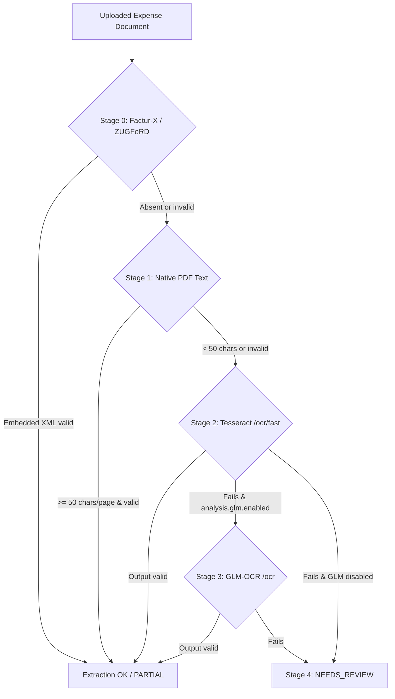

# Loyer and Co

Personal local application for rent receipts (quittances de loyer) and home-office expense statements (notes de frais d'occupation). The application is in French. Amounts are in euros and dates use DD/MM/YYYY.

An LLM (Ollama) can propose values extracted from invoices. It never computes amounts: every monetary calculation is done by the backend, and the user validates each proposed value. The application remains fully usable without an LLM.

## Stack

- Backend: Java 25, Spring Boot 4.1, Flyway, PostgreSQL 17, OpenHTMLToPDF / PDFBox
- Frontend: React 19, TypeScript, Vite, Vitest, Cypress
- LLM: Ollama (local), with a deterministic `mock-ollama` for tests
- Deployment: Docker Compose, nginx

## Prerequisites

- Docker Engine or Docker Desktop with Docker Compose v2.24.4 or later
- GNU Make (optional, for the shortcuts)
- Ollama on the host, or the Compose `ollama` profile (see below)

## Installation

```bash
cp .env.example .env        # then edit DB_PASSWORD at least
docker compose up --build -d
```

Open [http://localhost:8080](http://localhost:8080). The port is set by `FRONTEND_PORT` in `.env`.

Equivalent shortcut: `make up`.

To stop the stack: `docker compose down` (or `make down`). Data is kept in the `pgdata` volume and in `./data`.

## Configuration

All settings live in `.env` (git-ignored). The template is [.env.example](.env.example).

| Variable                            | Default                             | Purpose                                                                                                                                                                                                                              |
| ----------------------------------- | ----------------------------------- | ------------------------------------------------------------------------------------------------------------------------------------------------------------------------------------------------------------------------------------ |
| `FRONTEND_PORT`                     | `8080`                              | Host port of the web application                                                                                                                                                                                                     |
| `DB_NAME`, `DB_USER`, `DB_PASSWORD` | (required)                          | PostgreSQL credentials; compose refuses to start if unset                                                                                                                                                                            |
| `OLLAMA_BASE_URL`                   | `http://host.docker.internal:11434` | Ollama endpoint as seen from the backend container                                                                                                                                                                                   |
| `OLLAMA_MODEL`                      | `qwen2.5:7b`                        | Model used for extraction                                                                                                                                                                                                            |
| `WITH_LIBREOFFICE`                  | `false`                             | Build the backend image with LibreOffice (DOCX to PDF, see [Using LibreOffice](#using-libreoffice))                                                                                                                                  |
| `COLLABORA_PORT`                    | `9980`                              | Host port of the Collabora Online editor (DOCX templates)                                                                                                                                                                            |
| `COLLABORA_ENABLED`                 | `false`                             | Switches the DOCX Collabora editor in the app and its WOPI endpoints (`false`: no editor button, WOPI refused). Set `true` in `.env` to also start the Collabora Online service in Compose. DOCX built-in and uploads stay available |
| `OLLAMA_ENABLED`                    | `false`                             | Switches the AI analysis in the app (`false`: no AI badge, panels or admin LLM page, no LLM call). Set `true` in `.env` to also start the local Ollama service in Compose; use a host Ollama via `OLLAMA_BASE_URL` otherwise         |
| `BACKEND_PORT`, `DB_PORT`           | `8081`, `5432`                      | Host ports, used by the development overlay only                                                                                                                                                                                     |

## Ollama configuration

The backend reaches Ollama over HTTP. Choose one of the two options.

### Option A: Ollama on the host (default)

1. Install Ollama from [ollama.com](https://ollama.com).
2. On Linux, Ollama must listen on all interfaces so containers can reach it. Set `OLLAMA_HOST=0.0.0.0` in the Ollama service (for systemd: `sudo systemctl edit ollama.service`, add `[Service]` and `Environment="OLLAMA_HOST=0.0.0.0"`, then `sudo systemctl restart ollama`).
3. Pull the model:

   ```bash
   ollama pull qwen2.5:7b
   ```

4. Keep `OLLAMA_BASE_URL=http://host.docker.internal:11434` in `.env`. The compose file maps `host.docker.internal` to the host gateway on Linux.

### Option B: Ollama in Compose

```bash
# .env
OLLAMA_BASE_URL=http://ollama:11434

docker compose --profile ollama up --build -d
docker compose exec ollama ollama pull qwen2.5:7b
```

The model cache is stored in the `ollama_data` volume. For GPU use on NVIDIA hosts, uncomment the `deploy` block of the `ollama` service in [docker-compose.yml](docker-compose.yml).

## OCR service (GLM-OCR)

The application uses a dedicated container running the `zai-org/GLM-OCR` model on CPU via a Python FastAPI service (`ocr-service/`). The service parses PDF invoices and images directly into structured markdown and text.

### Build and run

To build and start the OCR container via Docker Compose:

```bash
docker compose up -d --build ocr
```

Or build and run the image standalone:

```bash
docker build -t ocr-service ./ocr-service
docker run -p 8000:8000 --memory=8g --cpus=4 ocr-service
```

### Health check and `curl` test

Check service health:

```bash
curl http://localhost:8000/health
# {"status":"ok"}
```

Send a document (PDF or image) for OCR extraction using GLM-OCR:

```bash
curl -X POST http://localhost:8000/ocr \
  -F "file=@/path/to/invoice.pdf"
```

Send a document for fast OCR extraction using Tesseract (`POST /ocr/fast`):

```bash
curl -X POST http://localhost:8000/ocr/fast \
  -F "file=@/path/to/invoice.pdf"
```

The fast endpoint preprocesses input documents via OpenCV (grayscale, deskew, denoise, upscale to ~300 DPI, adaptive threshold) and recognizes text with Tesseract using languages configured via `OCR_TESSERACT_LANGS` (default `fra+eng`). Both `/ocr` and `/ocr/fast` share the same serialized worker queue (returning HTTP 429 when saturated).

Sample JSON response:

```json
{
  "pages": [
    {
      "page": 1,
      "text": "Facture ... Total TTC : 42,00 €",
      "markdown": "# Facture ...\nTotal TTC : 42,00 €"
    }
  ],
  "total_pages": 1
}
```

### First-start model download time

On the very first run, the GLM-OCR model weights (~1.8 GB) are downloaded from Hugging Face into the container cache.

- **First startup**: expects 2 to 5 minutes depending on network bandwidth.
- **Subsequent starts**: model loads from the local cache in approximately 10 to 20 seconds.

### Resource monitoring (`docker stats`)

Monitor memory and CPU consumption during inference:

```bash
docker stats $(docker compose ps -q ocr)
```

- **Memory**: typically 4 to 6 GB RAM during model execution (container memory limit: 8 GB).
- **CPU**: uses 2 to 4 cores during OCR recognition (container CPU limit: 4 CPUs).

### HTTP client examples

#### Java (Spring `RestClient` with multipart and HTTP 429 retry)

```java
RestClient client = RestClient.builder()
    .baseUrl("http://ocr:8000")
    .requestFactory(new SimpleClientHttpRequestFactory() {{
        setConnectTimeout(Duration.ofSeconds(10));
        setReadTimeout(Duration.ofSeconds(120)); // timeout >= 120s
    }})
    .build();

MultiValueMap<String, Object> body = new LinkedMultiValueMap<>();
body.add("file", new ByteArrayResource(fileBytes) {
    @Override
    public String getFilename() {
        return "facture.pdf";
    }
});

int maxRetries = 3;
for (int attempt = 0; attempt <= maxRetries; attempt++) {
    try {
        OcrResponse response = client.post()
            .uri("/ocr")
            .contentType(MediaType.MULTIPART_FORM_DATA)
            .body(body)
            .retrieve()
            .body(OcrResponse.class);
        break;
    } catch (RestClientResponseException ex) {
        if (ex.getStatusCode().value() == 429 && attempt < maxRetries) {
            Thread.sleep(1000L * (1L << attempt));
            continue;
        }
        throw ex;
    }
}
```

#### TypeScript (`callOcr` helper with timeout >= 120s and HTTP 429 retry)

```typescript
import { callOcr, type OcrResponse } from "./api/ocrClient";

// file can be a File, Blob, ArrayBuffer or Uint8Array
const response: OcrResponse = await callOcr(file, "facture.pdf", {
  url: "http://ocr:8000/ocr",
  timeoutMs: 120_000, // enforced >= 120s
  maxRetries: 3,
});

for (const page of response.pages) {
  console.log(`Page ${page.page}:`, page.markdown);
}
```

## Expense extraction flow

When an expense receipt or invoice (PDF or image) is uploaded, the backend executes a staged pipeline that stops at the first valid result. Correctness is prioritized: a wrong amount is worse than a missing one.



### Stages overview

1. **Stage 0 - Factur-X / ZUGFeRD**: Extracts embedded UN/CEFACT CII invoice XML from PDF attachments using PDFBox + DOM without external dependencies.
2. **Stage 1 - Native PDF text**: Extracts text layer via Apache PDFBox. If the text has fewer than 50 characters per page (`analysis.min-native-chars`), the PDF is treated as a scan.
3. **Stage 2 - Tesseract (`POST /ocr/fast`)**: Preprocessed by OpenCV (grayscale, deskew, upscale to ~300 DPI, adaptive threshold) and recognized via Tesseract (`OCR_TESSERACT_LANGS=fra+eng`).
4. **Stage 3 - GLM-OCR (`POST /ocr`)**: Deep-learning document parser invoked only when Stage 2 fails and `analysis.glm.enabled=true`.
5. **Stage 4 - Manual review**: When all stages fail, the analysis finishes with `extractionStatus = "NEEDS_REVIEW"` (never guesses).

Every stage feeds the same French number/date parser and validator (`CalculationService`, `BigDecimal`, 0.02 € tolerance, sanity ceiling at 10,000 €).

### How to test each stage separately

- **Stage 0 (Factur-X)**:
  ```bash
  cd backend && ./mvnw test -Dtest=FacturXExtractorTest
  ```
- **Stage 1 (Native text)**:
  ```bash
  cd backend && ./mvnw test -Dtest=NativePdfExtractorTest
  ```
- **Stage 2 (Fast OCR / Tesseract)**:
  ```bash
  curl -X POST http://localhost:8000/ocr/fast -F "file=@my-ticket.png"
  ```
- **Stage 3 (GLM-OCR)**:
  ```bash
  curl -X POST http://localhost:8000/ocr -F "file=@my-invoice.pdf"
  ```
- **Full staged pipeline & fixtures**:
  ```bash
  cd backend && ./mvnw test -Dtest=StagedExpenseExtractorTest,StagedExtractionIntegrationTest
  ```
- **Real samples (optional)**:
  Place real invoice samples in `samples/` (git-ignored), then run:
  ```bash
  cd backend && ./mvnw test -Dtest=StagedExtractionIntegrationTest#optionalSamplesTest
  ```

## Usage

1. Open the application and review the settings (expense items, templates). Defaults are seeded at first start.
2. Create a rent receipt (quittance) or a home-office expense statement.
3. Upload supporting documents (invoices). The LLM proposes values; check and correct them before validating.
4. Generate the PDF. The preview, the on-screen total and the final PDF come from the same backend calculation.

Previous versions of documents are never overwritten: deletion is logical.

## Remote Mail Service

Sending generated rent receipt PDFs to tenants via e-mail can be delegated to an owner-hosted remote mail service.

### Configuration

In `.env` or environment variables:

- `APP_FEATURES_RENT_EMAIL_ENABLED=true` (defaults to `false`)
- `APP_MAIL_SERVICE_URL=https://mail.example.com/api/send` (HTTPS required; plain `http://` only allowed for `localhost` and `127.0.0.1`)
- `APP_MAIL_SERVICE_SECRET=<shared-hmac-secret>` (never logged, never exposed via API)

The feature flag `rentEmailEnabled` in `GET /api/features` evaluates to `true` only if `APP_FEATURES_RENT_EMAIL_ENABLED=true` and both URL and secret are non-empty. Additionally, users must explicitly grant consent via `PUT /api/rent-board/email-consent` before sending receipts.

### Remote Mail Request Schema

`POST <APP_MAIL_SERVICE_URL>`
Headers:

- `Authorization: Bearer <HMAC-Token>`
- `X-Mail-Token: <HMAC-Token>`
- `Content-Type: application/json`

Payload (JSON):

```json
{
  "recipient": "tenant@example.com",
  "subject": "Quittance de loyer - 2026-03",
  "body": "Bonjour,\n\nVeuillez trouver en pièce jointe votre quittance de loyer pour le mois de 2026-03.\n\nCordialement.",
  "filename": "quittance-2026-03.pdf",
  "pdfBase64": "<base64-encoded-pdf-bytes>"
}
```

### HMAC-SHA256 Token Verification

The short-lived authentication token is composed of two base64url-encoded parts separated by a dot: `<encodedPayload>.<encodedSignature>`.

1. **Payload**: `${expiresAtEpochSecond}:${nonce}:${recipientHash}:${pdfDigest}`
   - `expiresAtEpochSecond`: Unix epoch in seconds (60 seconds TTL).
   - `nonce`: Random UUID string.
   - `recipientHash`: Hex-encoded SHA-256 digest of the normalized (trimmed, lowercase) recipient email.
   - `pdfDigest`: Hex-encoded SHA-256 digest of the PDF file bytes.
2. **Signature**: `Base64URL(HMAC-SHA256(payload, secret))`
3. **Verification steps on the remote service**:
   - Split token into `encodedPayload` and `encodedSignature`.
   - Compute `expectedSignature = HMAC-SHA256(Base64URLDecode(encodedPayload), secret)`.
   - Verify that `Base64URLDecode(encodedSignature)` equals `expectedSignature` using constant-time comparison.
   - Parse payload into `[expiresAt, nonce, recipientHash, pdfDigest]`.
   - Check that current time is before `expiresAt`.
   - Check that `recipientHash` matches `SHA256(recipient)`.
   - Check that `pdfDigest` matches `SHA256(pdfBytes)`.

## Using LibreOffice

LibreOffice is used in two ways:

- **Editing DOCX templates in the browser.** The `collabora` service of [docker-compose.yml](docker-compose.yml) runs Collabora Online (LibreOffice in a browser). It starts with the stack.
- **Converting DOCX templates to PDF.** The backend image includes LibreOffice headless only when built with `WITH_LIBREOFFICE=true`. Without it, the HTML renderer is used as fallback.

### Edit a template in LibreOffice

1. Start the stack with `docker compose up --build -d` and check that `collabora` is running (`docker compose ps`).
2. Open the **Templates** page and upload a `.docx` template, or use an existing one.
3. On the card of the active template, click **Modifier dans LibreOffice**. The editor opens in a dialog and loads the document.
4. Edit the document in LibreOffice. Keep the variables listed in the **Variables** drawer.
5. Click **Enregistrer**. The file is saved as a new version of the template; the previous version is kept.
6. Close the editor with the cross (**Fermer l’éditeur**).

Notes:

- Only DOCX versions can be saved from LibreOffice. HTML versions are refused.
- The editor token is valid for 30 minutes. Reopen the editor if the session expires.
- The browser reaches Collabora on `http://localhost:9980` (`COLLABORA_PORT` in `.env`). For another address, build the frontend with `VITE_COLLABORA_URL=<url>`.
- Collabora fetches the template from the WOPI origin: the browser origin by default, or `VITE_WOPI_ORIGIN` when set. That origin must resolve from inside the Collabora container and match `aliasgroup1` in [docker-compose.yml](docker-compose.yml) (`http://backend:8080`). `make up` passes `VITE_WOPI_ORIGIN` to the frontend build (default `http://backend:8080`, override in `.env`). The dev overlay sets it on `vite`.

### Enable DOCX to PDF conversion

```bash
# .env
WITH_LIBREOFFICE=true

docker compose up --build -d
```

The build installs `libreoffice-writer` in the backend image. The image grows accordingly.

## Authentication and User Accounts

The application scopes documents, templates, leases and expense statements per user account.

### Default Seed Account

A default account is seeded automatically on first startup:

- **Email:** `thtran@homeofficeexpenses.local`
- **Password:** `thtran`
- **Role:** `ADMIN`

### Administration

The application provides an administration interface:

1. **User Administration (`/admin/users`)**:
   - Accessible from the sidebar navigation (**Paramètres** > **Administration utilisateurs**) or directly at `/admin/users`.
   - Reserved for accounts with the **`ADMIN`** role (such as the default seed account).
   - Allows administrators to manage user accounts, change user roles (`ADMIN` vs `USER`), and toggle module access (Société / LMNP) for each user.

### Creating a New Account (Sign Up)

1. **Sign up**: Go to `/register` (or `/confirm-email`), switch to registration mode and enter your email and a password (not blank, at most 100 characters).
   - Via API: `POST /api/auth/register` with `{"email":"...","password":"..."}` (returns `204 No Content`).
2. **Confirm email**: A confirmation link with a token is sent by email.
   - In local/Docker development (`make up` or `make dev`), incoming emails are captured by **Mailpit** at [http://localhost:8025](http://localhost:8025).
   - Click the confirmation link in Mailpit, or open `http://localhost:5173/confirm-email?token=<TOKEN>`.
   - Via API: `POST /api/auth/confirm-email` with `{"token":"..."}` (returns `204 No Content`).
3. **Log in**: Once confirmed, sign in with your email and password at `/login` or via `POST /api/auth/login`.

## Development

```bash
make dev
```

This starts PostgreSQL, the backend (host port `BACKEND_PORT`) and Vite on [http://localhost:5173](http://localhost:5173). Vite proxies `/api` to the backend.

## Tests

```bash
make test
```

This runs the backend tests (`backend/mvnw test`), the frontend unit tests (`npm test`) and the frontend build.

End-to-end tests (Cypress against the full stack, with `mock-ollama` and an ephemeral database):

```bash
make e2e-up        # build and start the e2e stack once per task
make e2e           # rebuild changed services, run the Cypress suite
make e2e 00-settings   # run one spec (prefix match)
make e2e-down      # remove the stack and its volumes, once the change is accepted
```

`make e2e` reuses the running stack, rebuilds only `backend`, `frontend` or `mock-ollama` when
their files changed since the previous run, and never tears the stack down. The Compose project
(`homeofficeexpenses-e2e`) never touches `./data` or `pgdata`; volumes are removed by
`make e2e-down` only. The exit code is the Cypress result.

## Backup and restore

| Data                                 | Location             | Backup                                                                                |
| ------------------------------------ | -------------------- | ------------------------------------------------------------------------------------- |
| Database                             | `pgdata` volume      | `docker compose exec -T db pg_dump -U "$DB_USER" "$DB_NAME" > backup-$(date +%F).sql` |
| Justificatifs, statements, templates | `./data`             | `tar czf data-$(date +%F).tar.gz data/`                                               |
| Ollama models (optional)             | `ollama_data` volume | Re-pull with `ollama pull`, or back up the volume                                     |

Restore the database with `docker compose exec -T db psql -U "$DB_USER" "$DB_NAME" < backup.sql` on a fresh stack. Restore `./data` by extracting the archive at the repository root while the stack is stopped.

## Sample data and demo files

- [backend/sample-facture.txt](backend/sample-facture.txt): sample EDF gas invoice (total 78,00 EUR).
- [frontend/cypress/fixtures/](frontend/cypress/fixtures/): invoices for the e2e scenarios (electricity, gas, fibre, telephone, insurance, and invalid or hostile cases), and valid and invalid HTML templates.
- [backend/src/main/resources/templates/defaut/](backend/src/main/resources/templates/defaut/): default templates for the rent receipt (`quittance.html`) and the expense statement (`note-frais.html`).

Templates are logic-less Mustache, sanitized HTML. Scripts and remote resources are not allowed.

## Repository layout

```
backend/            Spring Boot API, Dockerfile, tests
frontend/           React application, Dockerfile, nginx.conf, Cypress tests
mock-ollama/        Deterministic Ollama stand-in for tests
openapi/            API contract (openapi.yaml)
docker-compose.yml          Base stack
docker-compose.dev.yml      Development overlay
docker-compose.e2e.yml      End-to-end overlay
Makefile                    Shortcuts: up, dev, test, e2e-up, e2e, e2e-down, down
.github/workflows/ci.yml    CI: backend, frontend, e2e
```

## Assumptions

- Single-user, local deployment on a personal machine. The application is not exposed to the internet.
- Ollama runs on the host by default. Linux hosts must set `OLLAMA_HOST=0.0.0.0`.
- The default model is `qwen2.5:7b`. The LLM output is untrusted: it is constrained JSON validated server-side and is never applied without user validation.
- `./data` is a bind mount. The `data-init` service sets ownership to uid 10001, the non-root backend user, on each start.
- Docker Compose v2.24.4 or later is required for the `!reset` and `!override` merge tags used by the e2e overlay.
- The Cypress container runs as root, so files written to `frontend/cypress/screenshots` and `frontend/cypress/videos` may be owned by root on the host.
- LibreOffice is not included by default (`WITH_LIBREOFFICE=false`) because DOCX templates belong to phase 2.
- `openapi/openapi.yaml` is the API contract. Its changes are reported explicitly.
- Landlords, tenants and leases are separate directories. A lease binds one landlord, one tenant, the property address, the rent excluding charges and the charges advance; one active lease per couple (partial unique index on the non-deleted rows). Rent receipts record the selected pair; versions are per pair and every generation adds a new ACTIVE receipt, so several receipts can be active in the same month, including for the same pair.
- Landlord signatures are linked to a landlord. The generate page only offers the selected landlord's signatures plus legacy unlinked ones; an unlinked signature remains a fallback for existing data.
- The fresh-database initializer and `POST /api/e2e/reset` seed one landlord, one tenant and one active lease with the default home address and the default rent/charges. These values no longer live in `/api/settings`.
- Text extraction prefers the external `pdftotext` (poppler) with `-layout`, so columns and amounts stay aligned for the LLM. OCR uses `tesseract` with the French language pack (`fra`) for PDFs without a text layer. The backend image installs `poppler-utils`, `tesseract-ocr` and `tesseract-ocr-fra`; a local `make dev` run uses the host binaries when they are present.
- Missing external tools never fail an analysis: `pdftotext` failures, timeouts or empty output fall back to PDFBox, and a missing or failing OCR keeps the existing vision-image path sent to the LLM. The tools are configured by the `analysis.pdftext.*` and `analysis.ocr.*` properties (`ANALYSIS_PDFTEXT_COMMAND`, `ANALYSIS_PDFTEXT_TIMEOUT`, `ANALYSIS_OCR_ENABLED`, `ANALYSIS_OCR_COMMAND`, `ANALYSIS_OCR_LANGUAGE`, `ANALYSIS_OCR_TIMEOUT_PER_PAGE`).
- Rebuild the backend image (`docker compose build backend` or `make up`) to pick up the new runtime packages.
- The application is multi-company. Each company owns its expense items and statements, its home-office data and its issue place. A rent receipt takes its company from its lease only: a person lease has none and prints the landlord's issue place after « Fait à ». A note de frais chooses its company in the page header, with no persisted global selection: a single company is applied, several require an explicit choice, and the Settings company selection stays local to the page. A lease may optionally link to a company.
- Employees belong to one company and carry a descriptive title (`CEO`, `CFO`, `ACCOUNTANT`, `EMPLOYEE`). Signatures attach to an employee; landlord signatures remain attached to a landlord.
- RBAC is documented but not implemented: there is no authentication or authorization. The target matrix (CEO/CFO/accountant edit and export expense reports) lives in `product_prompt.md`; a future task enforces it.
- Existing data is migrated into company 1; the former `settings` row is preserved as `settings_legacy` and `/api/settings` is removed.
- Remote mail service: the rent receipt email sending feature is disabled by default. When enabled, requests to the remote mail endpoint are authenticated using a short-lived (~60s) HMAC-SHA256 token containing the recipient hash, PDF digest, nonce, and expiry timestamp.
